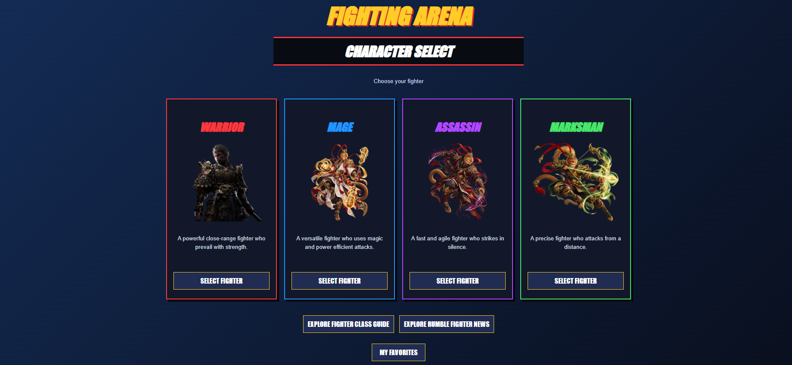
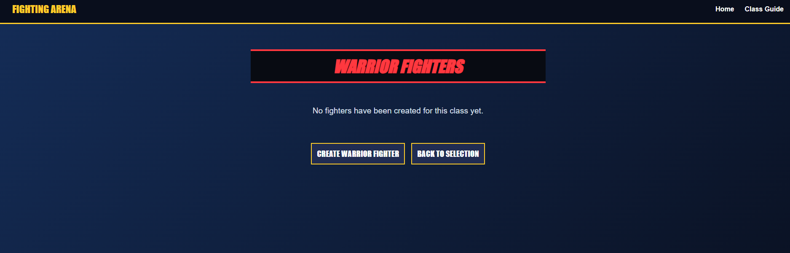
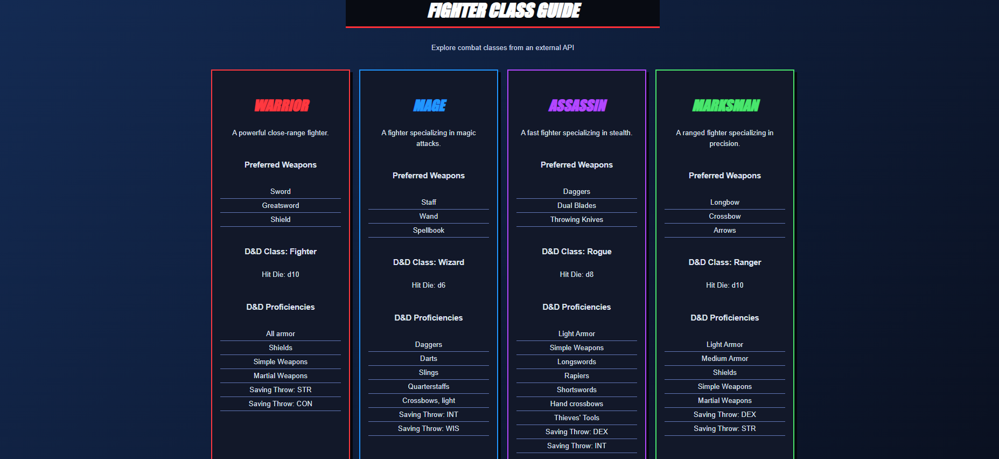
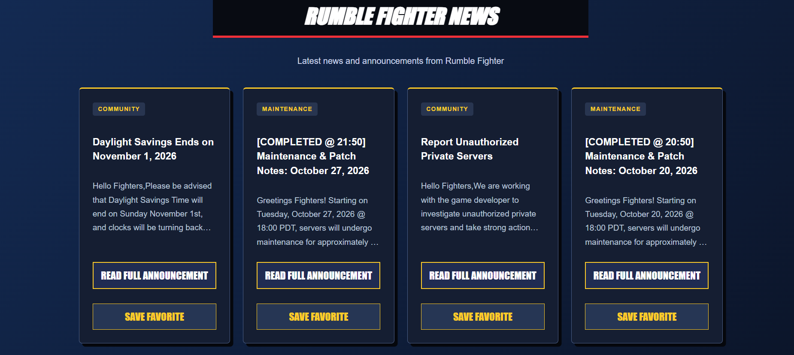

# Fighting Arena

**Role:** Developer  
**Project:** AppBuilder9000 — The Tech Academy  
**Tech Stack:** Python, Django, SQLite, HTML, CSS, JavaScript, Requests, Beautiful Soup, D&D 5e REST API

## Introduction

Fighting Arena is a Django web application inspired by fighting games and character-selection screens. The goal of my project was to let visitors choose a fighter class, create and manage their own characters, explore information from an external game API, and follow announcements from the official Rumble Fighter website.

I developed Fighting Arena as my individual application within the **AppBuilder9000** group project. I worked in my own Git branch and connected my app to the group's homepage and Django URL configuration. Throughout development, I combined back-end features—database models, forms, views, API requests, and HTML scraping—with front-end improvements designed to make the website feel like a fighting game.



## Core Technologies

- **Back end:** Python, Django
- **Front end:** HTML5, CSS3, JavaScript, Django template language
- **Database:** SQLite with the Django ORM 
- **API integration:** Requests, D&D 5e REST API
- **Web scraping:** Requests, Beautiful Soup (`bs4`)
- **Version control:** Git, Azure DevOps
- **Development environment:** PyCharm, virtual environment

## Key Features & Functionality

- **Character selection:** Choose from **Warrior**, **Mage**, **Assassin**, and **Marksman**, each with its own colors and fighter artwork.
- **Character creation and management:** Add fighters, view class-specific lists and individual details, edit existing characters, and delete characters.
- **Fighter Class Guide:** Retrieve D&D class data from a REST API and display selected fields alongside custom fighting styles and weapons.
- **Rumble Fighter News:** Use Beautiful Soup to extract announcements from the official Rumble Fighter website and present them as readable, linked news cards.
- **Favorite announcements:** Save scraped announcements to a Django model, browse saved entries, and remove favorites without duplicating articles.
- **Interactive UI:** Use class-colored borders, card entrance and hover animations, responsive layouts, and a JavaScript pointer-follow effect on character images.

## User Stories & Development Process

1. [Basic App Structure](#basic-app-structure)
2. [Create Model](#create-model)
3. [Display All Items](#display-all-items)
4. [Details View](#details-view)
5. [Edit and Delete Functions](#edit-and-delete-functions)
6. [Connect to API](#connect-to-api)
7. [Parse JSON](#parse-json)
8. [Beautiful Soup Setup](#beautiful-soup-setup)
9. [Parse HTML](#parse-html)
10. [Front-End Improvements](#front-end-improvements)
11. [Save Favorites](#save-favorites)
12. [Testing & Troubleshooting](#testing--troubleshooting)
13. [Conclusion](#conclusion)
14. [Key Learnings & Challenges](#key-learnings--challenges)

---

## Basic App Structure

I began by setting up the **CharacterSelection** Django project and its `characters` app. I created the app's `views.py`, `urls.py`, templates, and static folders, then used Django's template inheritance to keep the same navigation and page structure across my character pages. The app includes a `base.html` template and separate templates for class selection, fighter lists, details, forms, the API guide, scraping, and favorites.

One of the early challenges was integrating the standalone CharacterSelection application into the larger AppBuilder9000 group project. I needed to keep the app's routes working while also linking it from the shared homepage. I made the required settings and URL changes carefully so my app could be opened from the main project without replacing other group members' work.

```python
# URL examples from characters/urls.py
path('', views.home, name='CharacterSelectHome'),
path('class/<str:fighter_class>/', views.character_list, name='character_list'),
path('character/<int:pk>/', views.character_detail, name='character_detail'),
path('fighter-api/', views.fighter_api, name='fighter_api'),
path('fighter-scrape/', views.fighter_scrape, name='fighter_scrape'),
```

## Create Model

The next stage was creating a database-backed system for my fighters. I built a `Character` model to represent individual fighters and used a Django `ModelForm` to let users enter their information. Each character belongs to one of four classes and has details such as a name, description, health, attack, defense, and speed.

When a visitor chooses a class and clicks **Create Fighter**, I wanted the form to preserve that selection instead of letting them accidentally create a fighter in a different class. I handled that in the creation view by assigning the selected class before saving the model.


```python
form = CharacterForm(request.POST)

if form.is_valid():
    character = form.save(commit=False)
    character.fighter_class = fighter_class
    character.save()
    return redirect('character_detail', pk=character.pk)
```

I used Django migrations to apply the models to the local SQLite database and tested the form by adding character records.

## Display All Items

I created a page to list fighters belonging to the class a visitor selected. Instead of displaying the entire database without organization, the view filters `Character` objects by `fighter_class`. The results are passed to `character_list.html`, where a Django template loop creates a card for each matching fighter.

```python
def character_list(request, fighter_class):
    characters = Character.objects.filter(fighter_class=fighter_class)

    return render(request, 'characters/character_list.html', {
        'characters': characters,
        'fighter_class': fighter_class,
    })
```

Each card includes a **View Fighter** link. When a class has no saved fighters, the page displays a helpful empty-state message and still offers a way to create one.



## Details View

After the list page was working, I built an individual details page for each fighter. Django uses the selected character's primary key to retrieve the correct database record. The details template displays the fighter's name, class, description, health, attack, defense, and speed, along with buttons for editing, deleting, and returning to the rest of the app.

```python
def character_detail(request, pk):
    character = get_object_or_404(Character, pk=pk)

    return render(request, 'characters/character_detail.html', {
        'character': character,
    })
```

Using `get_object_or_404()` also makes the page respond appropriately when someone requests a character ID that does not exist.

## Edit and Delete Functions

I expanded the character features into a full create, read, update, and delete (CRUD) workflow. For editing, I reused the same `CharacterForm` with `instance=character`, which fills the form with the fighter's saved values. The updated record is saved back to the database after successful validation.

For deletion, I added a separate confirmation template. The confirmation page is displayed on a GET request, while the actual deletion happens only after the user submits a POST request. This helps prevent accidental deletion from a simple link click.

```python
if request.method == 'POST':
    character.delete()
    return redirect('CharacterSelectHome')
```

## Connect to API

To bring outside game information into Fighting Arena, I connected the project to the [D&D 5e REST API](https://www.dnd5eapi.co/). My **Fighter Class Guide** connects my four game classes to D&D classes:

| Fighting Arena class | D&D API class |
| Warrior | Fighter |
| Mage | Wizard |
| Assassin | Rogue |
| Marksman | Ranger |

I used Python's `requests` library to call the class endpoints and displayed the returned information on a dedicated `fighter_api.html` page. I also defined my own descriptions and preferred weapons to keep the external information connected to the Fighting Arena theme.

```python
url = f'https://www.dnd5eapi.co/api/2014/classes/{api_class}'
response = requests.get(url, timeout=10)
response.raise_for_status()
data = response.json()
```



## Parse JSON

Once I could retrieve API responses, I focused on selecting the fields I actually wanted instead of passing the complete JSON document directly to the template. I extracted the D&D class name, hit die, and proficiency names and combined them with custom Fighting Arena information.

```python
fighter_info = {
    'fighter_class': fighter_class,
    'api_name': data.get('name', 'Unknown'),
    'hit_die': data.get('hit_die', 'Unknown'),
    'proficiencies': [
        item.get('name', 'Unknown')
        for item in data.get('proficiencies', [])
    ],
    'description': fighter_styles[fighter_class]['description'],
    'weapons': fighter_styles[fighter_class]['weapons'],
}

api_characters.append(fighter_info)
```

In the template, I loop through the `api_characters` dictionaries to create four class cards. I added exception handling for failed requests so one unavailable API class does not necessarily prevent the remaining classes from appearing. Printing formatted JSON to the PyCharm terminal also helped me see exactly what the external service returned while testing.

## Beautiful Soup Setup

For the web-scraping assignment, I chose the official [Rumble Fighter website](https://www.playredfox.com/rumble_fighter) because it closely matches the theme of my app. I created a separate **Rumble Fighter News** page to show announcements without requiring visitors to leave Fighting Arena just to browse headlines.

I used `requests` to download the HTML and Beautiful Soup to create a navigable object:

```python
response = requests.get(
    'https://www.playredfox.com/rumble_fighter',
    timeout=10
)
response.raise_for_status()
soup = BeautifulSoup(response.text, 'html.parser')
```

I added comments throughout the scraping function to explain which elements I wanted and why I filtered them.

## Parse HTML

After retrieving the HTML, I searched for announcement links and filtered the results to relevant RedFox forum threads. I extracted each article's original URL, cleaned its text, and placed the information into dictionaries containing a title, short preview, category, and link.

```python
# Identify HTML links and extract readable text
links = soup.find_all('a', href=True)

for link in links:
    article_text = link.get_text(' ', strip=True)
    # Additional checks filter the relevant forum articles
```

```python
# Data sent to the template for each matching announcement
news_info = {
    'title': title,
    'preview': preview,
    'category': category,
    'url': article_url,
}
rumble_news.append(news_info)
```

One challenge was that several announcements used unusual decorative characters or had text without proper spacing. I improved the extraction using Unicode normalization, whitespace cleanup, shorter previews, and fallbacks for heavily stylized text. I also corrected an indentation issue where the page displayed an empty-results error despite finding announcements. The final page organizes up to eight announcements into compact cards and links back to the original articles.



## Front-End Improvements

I wanted the interface to resemble a fighting game rather than a standard database application. I used a dark navy background with gold accents, plus different colors for each fighter class: red for Warrior, blue for Mage, purple for Assassin, and green for Marksman.

Across the templates, I worked on:

- Glowing borders and hover effects on fighter cards.
- Card entrance animations that fade in and slide upward.
- A JavaScript mouse-follow effect for the Wukong fighter images.
- Consistent buttons, clear navigation, and readable empty/error states.
- Responsive Rumble Fighter news cards with the **Read Full Announcement** buttons aligned at the bottom.
- CSS classes scoped to my app so I would not override the group's shared Bootstrap styles.

For example, the fighter-image effect uses pointer movement to translate the artwork slightly toward the cursor, while CSS handles the card's independent hover animation. I also added reduced-motion handling to make the effects less distracting for users who prefer minimal animation.

## Save Favorites

I added a favorites feature that allows visitors to save interesting Rumble Fighter announcements. This required another Django model, `FavoriteAnnouncement`, to store the announcement title, preview, category, original URL, and time saved.

On the News page, a **Save Favorite** form submits the selected article's values to a Django view. I used `get_or_create()` with the announcement URL to avoid adding duplicate records. Another view retrieves all saved announcements for the Favorites page, and a POST-based removal view lets visitors delete favorites.

```python
# Save an announcement only if its URL is not already present
FavoriteAnnouncement.objects.get_or_create(
    url=article_url,
    defaults={
        'title': title,
        'preview': preview,
        'category': category,
    }
)
```

The favorites data is stored in SQLite, so saved announcements remain available after refreshing the browser or restarting Django. In this version, favorites are shared across the site rather than attached to individual user accounts.** User-specific favorites could be a future improvement.

## Testing & Troubleshooting

I tested the application throughout development rather than waiting until all features were complete. My checks included creating and editing fighters, verifying class filtering and detail links, printing and inspecting API JSON, opening scraped article links, saving and removing favorites, and checking that failed external requests display helpful messages.

Several problems helped me learn Django and the surrounding tools more thoroughly:

- **Django routing and imports:** I resolved URL and app-configuration issues when connecting CharacterSelection to AppBuilder9000.
- **Static files:** I investigated 404 errors for fighter artwork and discovered a homepage image reference using `.png` when the file was actually `.jpg`.
- **API and scraping:** I corrected variable mistakes, request-handling problems, and Beautiful Soup text extraction issues.
- **Template rendering:** I fixed an empty-results message that appeared because its condition ran inside the scraping loop.
- **CSS animations:** I adjusted entrance and hover effects after discovering that two animations using `transform` could conflict.
- **Database access:** I corrected Django ORM typos such as `object` instead of `objects` while developing the favorites page.
- **Version control:** I learned to stage relevant files, commit changes on my feature branch, and push them to Azure DevOps without including a local virtual environment or SQLite database.


## Conclusion

Fighting Arena allowed me to bring together several full-stack development skills in one project. What started as a character-selection page evolved into an application with database-driven CRUD operations, a game-class API guide, scraped Rumble Fighter announcements, saved favorites, and interactive front-end effects. The project also gave me practical experience integrating my work into a shared Django repository and troubleshooting issues across Python, templates, CSS, JavaScript, and Git.

I would like to continue improving the application with user-specific favorites, richer fighter statistics, additional automated tests, and further polish to the character-selection interface.

## Key Learnings & Challenges

**Django and database development:** I gained experience with models, migrations, forms, view functions, routing, and database queries through the Django ORM. Building the character and favorites features helped me understand how information flows from a user action to the database and back into a template.

**API integration and JSON parsing:** I learned to make HTTP requests, validate responses, extract nested JSON fields, handle failures, and display selected information through template context dictionaries.

**Web scraping and text cleanup:** Beautiful Soup taught me how to navigate HTML elements and collect relevant links and text. I also discovered how unpredictable real-world website formatting can be and why data cleaning matters for a readable user interface.

**UI/UX design:** I experimented with page transitions, hover effects, consistent card layouts, image movement, keyboard focus, and reduced-motion support. I became more comfortable balancing visual effects with usability.

**Collaboration and version control:** Working inside AppBuilder9000 helped me practice Git branches, commits, and pushes, while paying attention to the shared project files and CSS conventions used by teammates.

**Problem-solving and debugging:** From broken image paths to an ORM typo and conflicting CSS animations, I worked through problems by checking error messages, inspecting the relevant code, testing one change at a time, and verifying the result in the browser.


## Credits & Resources

- [D&D 5e REST API](https://www.dnd5eapi.co/) — external fighter-class information.
- [Rumble Fighter / RedFox Games](https://www.playredfox.com/rumble_fighter) — announcement source for the Beautiful Soup page.
[Django] - Web framework.
[Beautiful Soup] - HTML parsing library.

Jump To:  [Basic App Structure](#basic-app-structure),
 [Create Model](#create-model),
 [Display All Items](#display-all-items),
 [Details View](#details-view),
 [Edit and Delete Functions](#edit-and-delete-functions),
 [Connect to API](#connect-to-api),
 [Parse JSON](#parse-json),
 [Beautiful Soup Setup](#beautiful-soup-setup),
 [Parse HTML](#parse-html),
 [Front-End Improvements](#front-end-improvements),
 [Save Favorites](#save-favorites),
 [Testing & Troubleshooting](#testing--troubleshooting),
 [Conclusion](#conclusion),
 [Key Learnings & Challenges](#key-learnings--challenges)